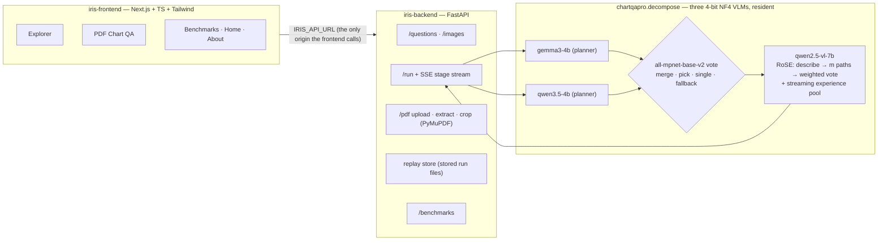

# IRIS — Iterative Reasoning over Inferred Sub-queries

IRIS is a chart question-answering assistant built for **low-vision and
visually impaired readers**. Ask it a factoid question about a chart — a
value, a label, a year, a comparison — and it answers with a plain-language
description of the chart, a confidence indicator, and the full reasoning
trace, all screen-reader friendly and readable aloud by the browser.

IRIS is built on the **RoSE** reasoning framework
([*Making Large Language Models Better Reasoners with Orchestrated Streaming
Experiences*](https://aclanthology.org/2024.emnlp-main.48/), Liu, He & Qiu,
EMNLP 2024) and evaluated on **ChartQAPro** (Masry et al., 2025). RoSE is the
framework; IRIS is the product. A North South University CSE499B capstone,
supervised by Dr. Md Adnan Arefeen.

**How it answers, in one paragraph:** two small models (Gemma 3 4B, Qwen3.5
4B) each read the chart and propose a two-step plan for the question. An
embedding vote compares the plans — agreeing plans are merged, otherwise the
plan closer to the question wins (a plan that failed to parse is excluded).
Qwen2.5-VL 7B then answers step by step along the chosen plan with the full,
unchanged RoSE pipeline: several sampled reasoning paths, a
confidence-weighted vote, and a streaming experience pool of past answers as
few-shot demonstrations.

**Accessibility is the product**: WCAG 2.2 AA minimum with AAA text contrast
(verified numerically per theme), light/dark/high-contrast themes following
the system preference, 18px base text with a persistent A−/A/A+ control to
200%, a dyslexia-friendly font toggle (OpenDyslexic; the default face is
Atkinson Hyperlegible), full keyboard navigation with visible focus rings and
a skip link, a polite live region announcing every pipeline stage, read-aloud
buttons (browser Web Speech, nothing leaves the machine), a chart viewer with
4× zoom / pan / invert, IRIS's own chart description as the image's text
alternative, and `prefers-reduced-motion` respected everywhere — including
the logo's pupil, which dilates while a run is in progress.

## Architecture



The backend imports `chartqapro.decompose` in-process (no shelling out). Live
runs queue one at a time because the GPU is shared; every stage streams out
over Server-Sent Events with a prewritten screen-reader announcement.

## Quick start — demo mode (no GPU)

Replay-only: stored results serve instantly, live runs are refused with a
visible notice.

```bash
python -m venv .venv && .venv/bin/pip install -r iris-backend/requirements.txt
cd iris-frontend && npm install && cd ..

make backend     # FastAPI on :8000 — demo mode on the committed sample data
make frontend    # Next.js on :3000
```

The defaults point at `iris-backend/sample_data/` (synthetic, clearly
labelled). For the real demo, drop the Kaggle run outputs
(`decomp_alg2.json` + `.csv`, optionally `decomp_alg1.*`) into a folder and
point `IRIS_RESULTS_DIR` at it — the JSON is preferred, as only it carries
the full RoSE paths — plus `IRIS_DATASET_JSON` / `IRIS_IMAGE_DIR` at the
dataset the notebooks build.

## Quick start — GPU host (live runs)

Needs a CUDA GPU with ~13 GB free (T4 ×2 works; the three NF4 models stay
resident) and the pinned stack:

```bash
.venv/bin/pip install -r requirements-pinned.txt \
                      -r iris-backend/requirements.txt
huggingface-cli login        # Gemma 3 is gated — accept its license first

IRIS_DEMO_MODE=false \
IRIS_DATASET_JSON=/path/chartqapro_factoid.json \
IRIS_IMAGE_DIR=/path/images \
IRIS_POOL_PATH=/path/decomp_alg2.json \
make backend
```

On startup the backend verifies gated access, loads gemma3-4b, qwen3.5-4b
and qwen2.5-vl-7b once (4-bit NF4) plus the all-mpnet-base-v2 embedder, and
seeds the 7B experience pool from `IRIS_POOL_PATH` so the first question
answers few-shot. The pool is read-only during runs unless
`IRIS_POOL_STREAM=true`.

## Environment variables

| Variable | Meaning | Default |
|---|---|---|
| `IRIS_DATASET_JSON` | dataset JSON (notebook record shape) | sample data via Makefile |
| `IRIS_IMAGE_DIR` | chart images, served at `/images/<name>` | sample data via Makefile |
| `IRIS_RESULTS_DIR` | stored run files for replay (`decomp_alg2.json`/`.csv`, `decomp_alg1.*`) | `chartqapro/results/decompose` |
| `IRIS_POOL_PATH` | results JSON that seeds the 7B experience pool | unset → empty pool |
| `IRIS_POOL_STREAM` | let live runs grow the pool | `false` |
| `IRIS_DEMO_MODE` | force replay-only mode | auto: `true` when CUDA absent |
| `IRIS_UPLOAD_DIR` | uploaded PDFs and crops | a temp dir |
| `IRIS_CORS_ORIGINS` | allowed frontend origins | `http://localhost:3000` |
| `IRIS_API_URL` | backend origin — the **only** host the frontend calls | `http://localhost:8000` |

`.env.example` documents the same list.

## How the frontend maps to the decompose package

| UI | Backend | chartqapro code |
|---|---|---|
| Explorer → planner checkboxes, final-model radio | `POST /run {planners, final_model}` | `decompose.decomp_runner._run_alg2(planners=…, final_model=…)` (parameterized; defaults unchanged) |
| Trace → "Plan" cards with fallback flags | SSE `stage.decompose` | `decompose.decomposer.decompose` (JSON parse, `[question, question]` fallback) |
| Trace → "Vote" card with pair similarities | SSE `stage.vote` | `decompose.vote.choose_decomposition` — merge / pick among non-fallback proposals, `single:<model>` when one is usable, `fallback` when none (fixes the cosine-1.0 defect) |
| Chart description under the viewer | SSE `stage.describe` | `rose_chartqapro._DESCRIPTION_PROMPT`, always generated and cached per chart (even in fast mode, which otherwise disables the two-stage pass) |
| Trace → reasoning paths, streamed | SSE `stage.path` | a runtime tap on `rose_chartqapro.call_vlm` during `process_one` (no source change) |
| Answer card: verdict + agreement badge | SSE `stage.final` | `scoring.is_correct` — the single source of truth for correctness |
| Fast / spec-exact toggle | `fast_mode` | runtime mirror of the fast notebooks: `M_PATHS=3`, two-stage off |
| Question text (never `"['…']"`) | dataset loader | `iris_backend.datasets.unwrap_question` (change #3) |

The three permitted changes to existing Python code are exactly: the runner
parameters, the vote's fallback exclusion, and the question-list unwrap —
each with tests. `scoring.py`, `rose_chartqapro.py` hyperparameters and
`routing/` are untouched.

## Tests

```bash
make test-backend   # iris-backend pytest (demo endpoints, PDF flow, mocked
                    # live run) + chartqapro/tests/test_decompose.py
make test-frontend  # Playwright: keyboard-only Explorer and PDF flows,
                    # axe-core on every page in all three themes
make check-hosts    # zero-cost check: no external hostnames in IRIS source
```

CI (`.github/workflows/ci.yml`) runs all three on every push.

## Zero-cost constraint

IRIS runs with **no paid services of any kind**: the frontend calls only the
IRIS backend (every font and script is bundled locally — no CDNs, no
analytics), the backend uses only locally loaded open-weight Hugging Face
models and local libraries (PyMuPDF for PDFs, browser Web Speech for TTS),
and `scripts/check_hostnames.py` fails CI if any IRIS source file references
a hostname other than localhost, 127.0.0.1 or huggingface.co.

### Free hosting paths

**(a) Live demo on a free GPU session** — run the backend in a Kaggle (T4 ×2)
or Colab session: install the pinned stack, start `uvicorn` in live mode,
and expose port 8000 through a free tunnel
(`cloudflared tunnel --url http://localhost:8000`, or `ngrok http 8000`).
Point the frontend's `IRIS_API_URL` at the tunnel URL. Sessions are
time-boxed; the experience pool reseeds from `IRIS_POOL_PATH` each start.

**(b) Permanent demo-mode deployment (replay only, no GPU)** — the frontend
builds statically and deploys on Vercel's free tier (set `IRIS_API_URL` at
build time); the backend in demo mode is CPU-only and small, so it fits the
Hugging Face Spaces or Render free tier — ship it with the dataset JSON,
images and stored run files, set `IRIS_DEMO_MODE=true`, and add the
frontend's origin to `IRIS_CORS_ORIGINS`. A paid GPU host is never required.

---

# The research underneath

The sections below document the RoSE reproduction and the extensions IRIS is
built from. The GPU experiments run in notebooks (Kaggle/Colab); everything
after inference is CPU-only.

## What RoSE does

RoSE wraps an LLM so it **self-improves as it answers questions**:

1. The LLM answers a reasoning question with chain-of-thought, sampling several
   paths and taking a **self-consistency** majority vote.
2. The answered question + its reasoning are stored in a **streaming experience pool**.
3. For each new question, RoSE embeds it, ranks pool items by **similarity**,
   splits them into **buckets** (for diversity — avoids the "copy effect"), and
   from each bucket picks the experience with **low uncertainty** and **high
   complexity** as a few-shot demonstration.
4. As the pool grows, accuracy climbs above the **Zero-Shot-CoT** and **Auto-CoT**
   baselines.

## ChartQAPro Extension

We extend RoSE from text-only (CommonsenseQA) to vision (chart images). The
mechanism is unchanged — streaming pool, similarity bucketing, entropy
uncertainty, complexity selection — but the questions are now about charts the
model has to read.

| Dataset | Model | Questions | Method |
|---------|-------|-----------|--------|
| ChartQAPro | Qwen2.5-VL-7B-Instruct (4-bit) | Factoid + MCQ | RoSE-CQA (this work) |

Inference needs a GPU, so it runs in a notebook (Colab / Kaggle T4) —
but everything **after** inference is CPU-only. A run logs
every sampled reasoning path, so it can be re-scored, ablated, judged and
exported on a laptop without touching a GPU again.

### The pipeline

| File | Does |
|------|------|
| `chartqapro/rose_chartqapro.py` | the run: pool, orchestration, m sampled paths, voting |
| `chartqapro/scoring.py` | answer extraction, normalization, correctness — no GPU deps, so it is the single source of truth for every verdict |
| `chartqapro/ablate.py` | recomputes the vote under all four aggregation configs, offline |
| `chartqapro/rescore_judge.py` | LLM judge for answers that are right but written differently |
| `chartqapro/export_csv.py` | results → CSV (`--per-path` for one row per reasoning path) |
| `chartqapro/summarize.py` | the whole run as JSON |

### Extensions beyond the paper

Ten deviations, each separately switchable, so a faithful baseline and the
improved system can both be reported (`PAPER_FAITHFUL = True` disables all ten).
The three that only change how the m per-path answers are **combined** can be
ablated from a finished run; the rest change what the model is shown or how it
decodes, so each needs its own run.

| Extension | Ablatable offline? |
|---|---|
| `numeric_vote_clustering` — group numeric answers within tolerance, take the median of the largest group | **yes** |
| `drop_malformed_paths` — exclude paths with no `Final Answer:` line from the vote | **yes** |
| `confidence_weighted_vote` — weight each path by decoding and well-formedness | **yes** |
| `mcq_permute_options` — rotate MCQ option order across paths so position bias cancels | no (prompt) |
| `type_aware_retrieval` — retrieve demonstrations only from the same question type | no (retrieval) |
| `greedy_first_path` — decode path 0 at T=0 | no (decoding) |
| `chart_reading_scaffold` — axis-and-units-first prompt scaffold | no (prompt) |
| `mcq_demo_anchor_fix` — store MCQ demos as `(B) 45%` so the letter stays anchored to a value | no (pool contents) |
| `two_stage_reasoning` — describe the chart first, then answer from that description | no (prompt) |
| `visual_hybrid_retrieval` — blend CLIP image similarity into retrieval | no (retrieval) |

### Run it

```bash
# 1. inference (GPU) — Notebook/RoSE_ChartQAPro_Notebook.ipynb
#    writes results/rose_results.json + results/meta.json

# 2. everything else is CPU-only
cd chartqapro
python ablate.py        results/rose_results.json --by-type
python rescore_judge.py results/rose_results.json --judge ollama \
       --out results/verdicts.json
python export_csv.py    results/rose_results.json --per-path
```

## Model Routing (Stage 1 — pilot)

Running every chart question through the 7B model is wasteful: many questions
are easy enough for a 4B model that answers in a fraction of the time. The
routing extension decides **per question** which model to use — not with a
trained classifier, but with the same ingredient RoSE itself is built on:
**experience**.

The idea in plain language: on a small pilot sample, run *all* the candidate
models and remember which ones got each question right. For every new
question, find the most similar pilot questions (same `all-mpnet-base-v2`
embeddings RoSE retrieves demonstrations with) and ask: *did the small model
get questions like this right?* If its similarity-weighted hit rate over the
K=5 nearest neighbours clears a threshold (τ=0.6), route the question there;
otherwise escalate — the 7B model is always the fallback, never a gamble.

| Model | Role | Params |
|---|---|---|
| `google/gemma-3-4b-it` | cheap first choice | 4.3B |
| `Qwen/Qwen3.5-4B` (unified VL) | cheap second choice | 4.0B |
| `Qwen/Qwen2.5-VL-7B-Instruct` | fallback / escalation | 8.3B |

All 4-bit on a T4. Everything lives in `chartqapro/routing/`; only
`pilot_runner.py` needs a GPU. Correctness inside the pool is recomputed with
`scoring.py`, so the router can never disagree with the dashboard about what
"got it right" means.

### Reproduce the pilot

```bash
cd chartqapro

# 1. the seeded 150-question sample, drawn from the cached 7B run's ids
python scripts/make_pilot_sample.py results/rose_factoid.json \
       --n 150 --seed 499 --out results/pilot/sample_ids.json

# 2. (GPU, once per 4B model — Kaggle/Colab) RoSE over the sample
python -m routing.pilot_runner --model gemma3-4b \
       --dataset chartqapro_factoid.json \
       --sample results/pilot/sample_ids.json \
       --out results/pilot/pilot_gemma3-4b.json
# …and again with --model qwen3.5-4b

# 3. build the routing pool (CPU; 7B hits come from the cached run —
#    see results/pilot/PROVENANCE.md: it covers the first 540 questions)
python -m routing.pool \
       --results gemma3-4b=results/pilot/pilot_gemma3-4b.json \
                 qwen3.5-4b=results/pilot/pilot_qwen3.5-4b.json \
                 qwen2.5-vl-7b=results/rose_factoid.json \
       --sample results/pilot/sample_ids.json \
       --out results/pilot/routing_pool.json

# 4. every pilot number: per-model accuracy & latency, leave-one-out routed
#    accuracy vs always-7B vs oracle, routing shares, mean params per query
python -m routing.evaluate_pilot results/pilot/routing_pool.json \
       --out results/pilot/pilot_report.json

# CPU tests (synthetic embeddings, no downloads)
python tests/test_routing.py
```

Exact library versions are pinned in `requirements-pinned.txt`; each pilot
run also writes the resolved model revision and installed versions into its
`*_meta.json`, so a finished run is self-describing. The cached 7B run
covers the **first 540** factoid questions (`results/pilot/PROVENANCE.md`
has the full story), so the pilot lives inside that half. Stage 2 (routing
the remaining questions on Kaggle) is a separate notebook built on
`routing/router.py::route_file`; its routed-vs-always-7B comparison is
limited to the cached half unless the 7B arm is re-run.

## Query Decomposition (two arms, no routing)

A second way to spend the small models: instead of *replacing* the 7B on
easy questions (routing), help it on every question by splitting the
question into two simpler sub-queries first. Both algorithms end in the
**full, unchanged RoSE pipeline on Qwen2.5-VL-7B** (same m=5, k=3, λ=1.2,
T=0.8; a single streaming 7B experience pool) and never import
`chartqapro/routing/` — `tests/test_decompose.py` enforces that.

**Algorithm 1 — decompose → parallel answer → evidence → RoSE.** The 7B
splits the question into two sub-queries (JSON list; `[question,
question]` fallback on parse failure). Gemma 3 4B answers sub-query 1 and
Qwen3.5-4B answers sub-query 2 against the chart, each with 3 sampled
paths and the agreement ratio as confidence. The sub-answers are
prepended to the RoSE reasoning prompt as an evidence block; the final
answer still comes from RoSE's own confidence-weighted vote.

**Algorithm 2 — both small models decompose → vote → RoSE.** Gemma and
Qwen3.5 each propose two sub-queries. An `all-mpnet-base-v2` vote either
**merges** agreeing proposals (pairwise cosine ≥ 0.8 after best matching)
or **picks** the proposal whose sub-queries sit closer to the original
question; the rule that fired is logged per question. A proposal whose
parse fell back is excluded from the vote (`single:<model>` /
`fallback`). RoSE runs with the chosen sub-queries inserted as "answer
these in order, then the main question" steps. No small model answers
anything. This is the algorithm IRIS runs live.

Everything lives in `chartqapro/decompose/` (`prompts.py`,
`decomposer.py`, `subanswer.py`, `vote.py`, `models.py`,
`decomp_runner.py`). The runner mirrors the routed runner: all three
models resident, a checkpoint after every question (errored rows retried
on resume), a graceful `--budget-h` session budget, a gated-access check
up front, and per run a per-question CSV, a per-stage summary CSV and a
meta JSON with resolved revisions + library versions + the algorithm
config. Correctness is always `scoring.py`'s verdict.

```bash
cd chartqapro

# GPU (Kaggle T4 x2) — one notebook per algorithm, first 250 factoids:
#   chartqapro/notebooks/decomp_alg1_chartqapro.ipynb
#   chartqapro/notebooks/decomp_alg2_chartqapro.ipynb
# Each defaults to FAST_MODE=True (m=3 paths, no two-stage description
# pass, no CLIP retrieval, smaller image grid) — roughly half the
# per-question cost; the meta JSON records the exact config either way,
# and FAST_MODE=False reproduces the routed run's spec-exact pipeline.
# Or by hand, one algorithm at a time:
python -m decompose.decomp_runner --algorithm 1 \
       --dataset chartqapro --data /kaggle/temp/chartqapro_factoid.json \
       --n 250 --out results/decompose/decomp_alg1.json

# CPU tests (mocked models, no downloads)
python tests/test_decompose.py

# CPU: the cross-arm table — accuracy, mean params/q, mean latency/q,
# and Alg 1's (sub-answer right, final wrong) / (sub wrong, final right)
# counts; rescores every arm with scoring.py on their common questions
python results/compare_arms.py
```
